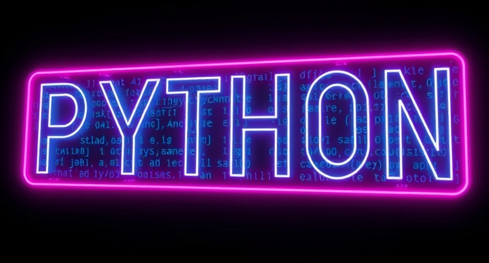

import DefinitionList from "@tdev-components/DefinitionList";
import CmsText from '@tdev-components/documents/CmsText';
import WithCmsText from '@tdev-components/documents/CmsText/WithCmsText';
import Restricted from '@tdev-components/documents/Restricted';

# Programmieren

In diesem Themenbereich beschäftigen wir uns mit Algorithmen und mit den Grundlagen der Programmierung in Python.

<Restricted id='ae2b1027-899d-4118-9d08-c98f4c7f9082'>
  ## Folien
  Die Unterrichtsfolien zu diesem Themebereich finden Sie [hier](https://erzbe-my.sharepoint.com/:f:/g/personal/friederike_metz_gbsl_ch/EreCfujGJmlEkVeBpqZDnP0BK4fwZcqgHHLYpVfcGw_NlA?e=DdIN0D).
</Restricted>

## Proben
### Algorithmen
<DefinitionList>
  <dt>Zeit</dt>
  <dd>45 Minuten</dd>

  <dt>Format</dt>
  <dd>Theoriefragen auf Papier</dd> 
  
  <dt>Hilfsmittel</dt>
  <dd>
    - Taschenrechner
    - keine anderen Hilfsmittel
  </dd>

  <WithCmsText entries={{note: '0c052054-e36a-4c38-a178-94f84156bbe6'}}>
    <dt>Note</dt>
    <dd>__<CmsText name="note" />__ (<CmsText name="punkte" />/?? Punkten)</dd>
  </WithCmsText>
</DefinitionList>

:::info[Prüfungsstoff]
- Sie können für einen gegebenen Sachverhalt entscheiden, ob es sich dabei um einen Algorithmus handelt oder nicht und dies begründen.
- Sie können einen gegebenen Algorithmus auf die **sechs Kriterien** (Allgemeinheit, Eindeutigkeit, Ausführbarkeit, Endlichkeit, Korrektheit und Determiniertheit) untersuchen und Ihre Entscheidung (bei Bedarf unter entsprechenden Annahmen) begründen.
- Sie können die verschiedenen **Strukturelemente** eines Algorithmus (Sequenz, Wiederholung (Schleife), bedingte Ausführung / Verzweigung, Unterprogramm, Parameter) erklären, an Beispielen demonstrieren, voneinander abgrenzen und bei der Entwicklung eigener Algorithmen korrekt verwenden.
- Sie können für ein gegebenes algorithmisches Problem einen Algorithmus entwickeln, der dieses Problem löst. Sie können diesen Algorithmus als formal korrektes **Flussdiagramm** darstellen.
- Sie können die Begriffe _inkrementieren_ und _dekrementieren_ definieren.
- Sie können die Ausführung eines gegebenen **Struktogramms** Schritt für Schritt nachvollziehen und die entsprechende(n) Ausgabe(n) korrekt bestimmen.
:::

### Programmieren
<DefinitionList>
  <dt>Zeit</dt>
  <dd>45 Minuten</dd>

  <dt>Format</dt>
  <dd>Praktische Aufgaben auf Webseite (eventuell Theoriefragen auf Papier)</dd> 
  
  <dt>Hilfsmittel</dt>
  <dd>
    - keine Hilfsmittel beim Theorieteil
    - Turtle Cheatsheet
    - keine anderen Hilfsmittel (Google, KI, …) erlaubt
  </dd>

  <WithCmsText entries={{note: '0c052054-e36a-4c38-a178-94f84156bbe6'}}>
    <dt>Note</dt>
    <dd>__<CmsText name="note" />__ (<CmsText name="punkte" />/?? Punkten)</dd>
  </WithCmsText>
</DefinitionList>

:::info[Prüfungsstoff]
- Sie können erklären, weshalb man zum Programmieren eine _formale_ Sprache benötigt.
- Sie können vier Kernunterschiede zwischen natürlichen und formalen Sprachen aufzählen und erläutern.
- Sie können den Unterschied zwischen for- und while-Schleifen erklären, typische Einsatzgebiete nennen und beide Schleifenarten in Turtle-Programmen korrekt einsetzen.
- Sie können Variablen definieren und verändern sowie deren Zweck zur Speicherung und Veränderung von Werten erklären.
- Sie können erklären, was Datentypen sind, und die Datentypen int, float und string unterscheiden, an Beispielen erläutern und korrekt in Variablen (z. B. in Turtle-Programmen) verwenden.
- Sie können Variablen in Kombination mit Schleifen und Turtle-Befehlen verwenden, um wiederholte oder parametrisierte Zeichnungen zu erstellen.
- Sie können den Einsatz von Zufallszahlen (z. B. für Farben, Längen oder Richtungen) erklären und Zufall gezielt in Turtle-Programmen verwenden.
- Sie können Eingaben vom Benutzer einlesen und diese in einem Programm weiterverarbeiten.
- Sie können Ausgaben erzeugen und erklären, wozu Ein- und Ausgabe in Programmen dienen.
- Sie können bedingte Anweisungen (if, elif, else) korrekt einsetzen und erklären, wie Programme dadurch Entscheidungen treffen.
- Sie können Verzweigungen verschachteln (z. B. if innerhalb von if oder Schleifen) und deren Ablauf nachvollziehen.
- Sie können einfache Programmierfehler erkennen, analysieren und beheben (Debugging), z. B. Syntaxfehler oder logische Fehler.
- Sie können ein strukturiertes, gut lesbares Turtle-Programm schreiben, das Variablen, Schleifen, Verzweigungen und ggf. Zufall sinnvoll kombiniert, um eine vorgegebene Grafik umzusetzen.
:::

---
